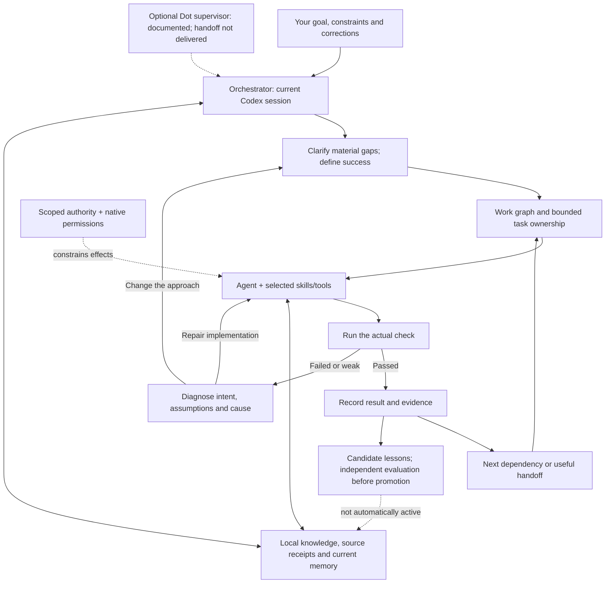

# Explain the harness in two minutes

**It gives coding agents a shared local work record and evidence trail.** The
model chooses useful actions; files and checks preserve what happened. It can
revisit design or research when a test exposes a wrong assumption. It is not a
guarantee of error-free work or an independently proven self-improving AGI.

Current local build: **2.0.0.dev3 plus recorded repairs**. Stable-v2 qualification,
all-device parity and a whole-task token improvement remain unproved.

## One picture



Prerequisites form a dependency graph; individual tasks have states and can
revisit earlier work. The orchestrator joins results and runs integration
checks. This is broader than a decision tree, but the diagram does not claim an
installed universal scheduler or autonomous external event bridge.
Diagram source is editable Mermaid; standalone rendering is not visually verified.

## The four layers

| Layer | What it contributes |
|---|---|
| Framework | Durable task graph, ownership, bounded execution, recovery and checked completion |
| Methodology | Proportionate research/design/code/test steps; diagnosis when evidence contradicts the approach |
| Philosophy | Goals, assumptions, constraints, counterexamples and tradeoffs behind a design choice |
| Knowledge vault | Original evidence plus source-linked views, scoped lookup, corrections and handoffs |

They are connected, not four compulsory rituals for every small question.

## Memory, without the magic claims

- **Task state:** project plan and handoff packets; another session can inspect
  the current result and next step without a message exchange.
- **Shared memory/KB:** MCP-accessible facts, lessons and configured documents.
  Current retrieval is lexical/BM25/FTS5. URL inventory is not ingested content.
- **Reader diagnostics:** newly loaded MCP readers report captured selection and
  loaded-method identity in metadata. A fresh reader sees the new capability
  note; this existing connection still misses it. See [the scoped repair](kb-runtime-repair-20261103.md).
- **Typed project evidence:** immutable revisions and exact source receipts.
  Explicit `memory-read --sources` can reveal a condition a note omitted.
- **Learning:** checked observations become candidates. Independent quality,
  complete usage, authorized activation and rollback are still required.

There is no qualified installed embedding/reranker/whole-corpus graph service.
No finite context window can guarantee perfect memory. Originals, scope, history
and uncertainty must survive summaries.

## What the latest native demonstration showed

A fresh Codex reader used the installed CLI to read a pending note and its saved
source. It recovered **passing checks AND ticket-owner approval**, kept the note
pending, and did not deploy. Four observed commands stayed within the assigned
read scope; the owned process group ended and config/source hashes stayed equal.

Its general answer omitted the lexical/paraphrase limitation. That original case
therefore remains PARTIAL. Functional source recovery is not a general reasoning
or token-efficiency result. Detailed trace and root review:
`.harness-work/retrieval/source-reader/receipts/`.

## Safety and compatibility

Adaptive policy judges the effect and target, reuses valid scoped approval, and
asks about unsafe unapproved effects or consequential uncertainty. Lessons cannot
grant permission. Custom hooks remain owner-disabled; native restrictions still
apply. There is no proven trained safety classifier.

Copilot's portable MCP override was repaired from official current documentation;
source/process compatibility is tested separately from live client loading.
Dot coordination is documented, but current direct UI access was refused and
the installation message has not been sent. See
[client capability notes](client-discovery-20261103.md).

## Three safe inspection commands

From the canonical project, using the installed `harness` on PATH:

```sh
harness privileges
harness handoff --task v2-completion --packet orchestrator.md
harness status --matrix
```

These inspect policy, the bounded current handoff and adapter coverage. A matrix
entry or completed process is not proof of useful task completion. Refer to the
root packet for current gates, full-regression results and unresolved requirements.
