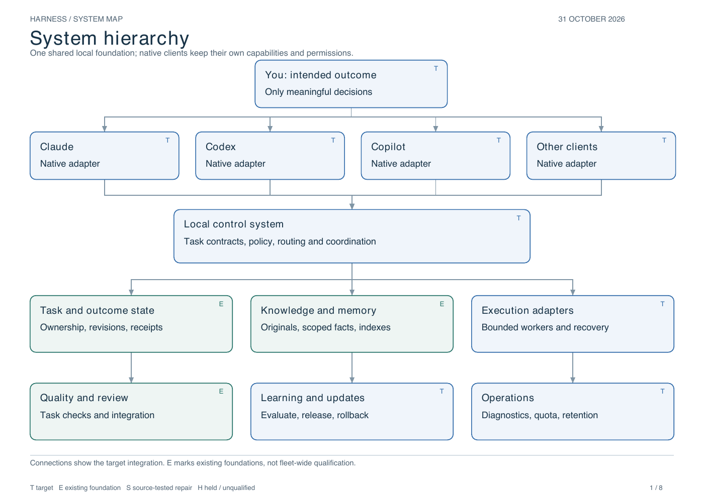
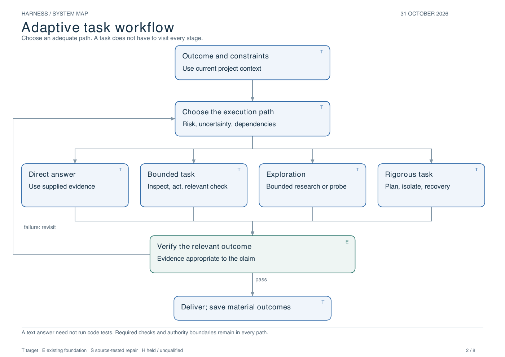
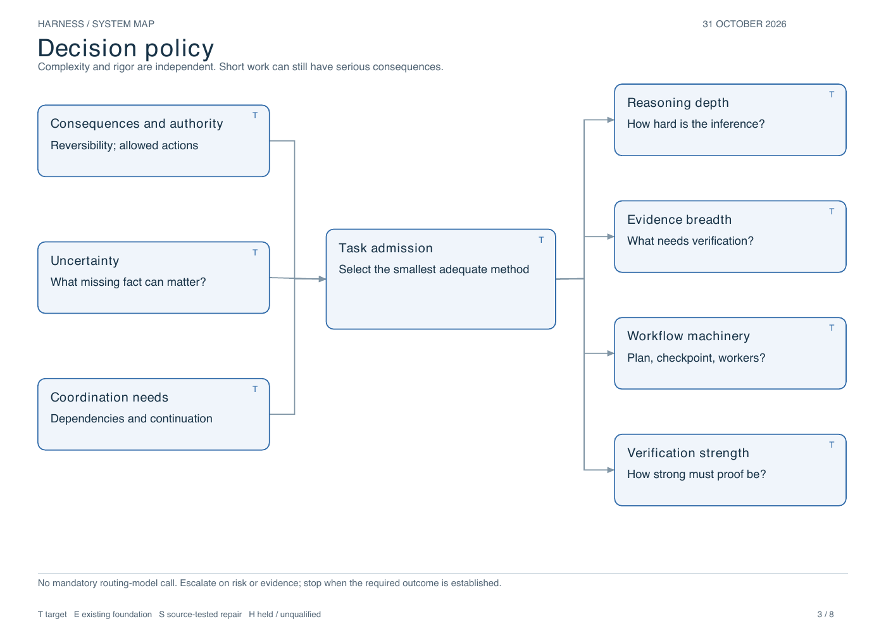
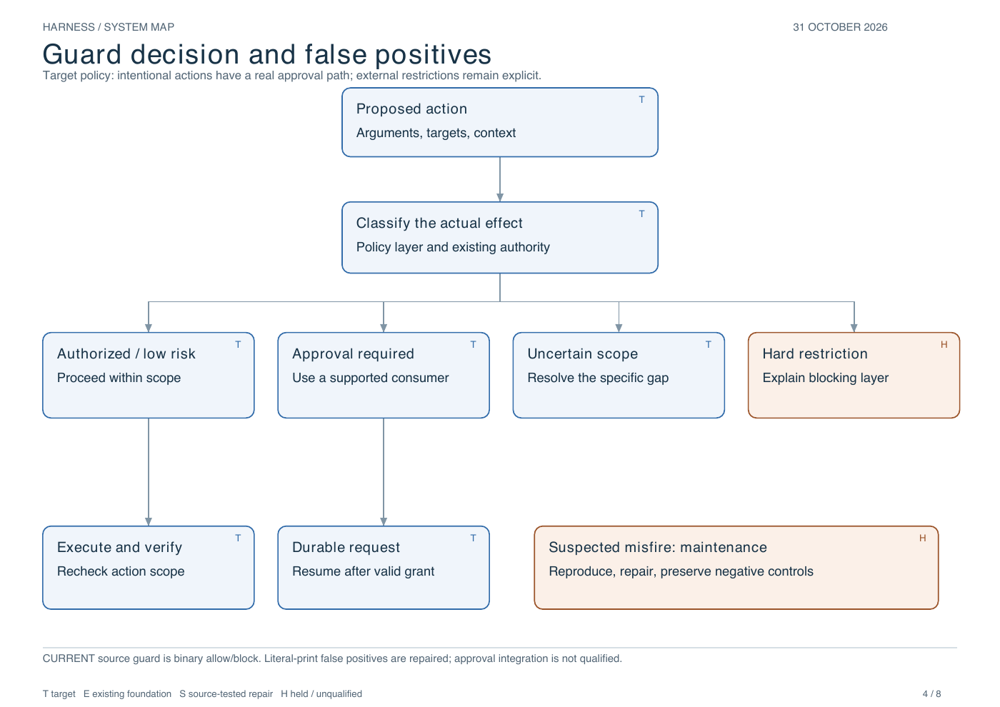
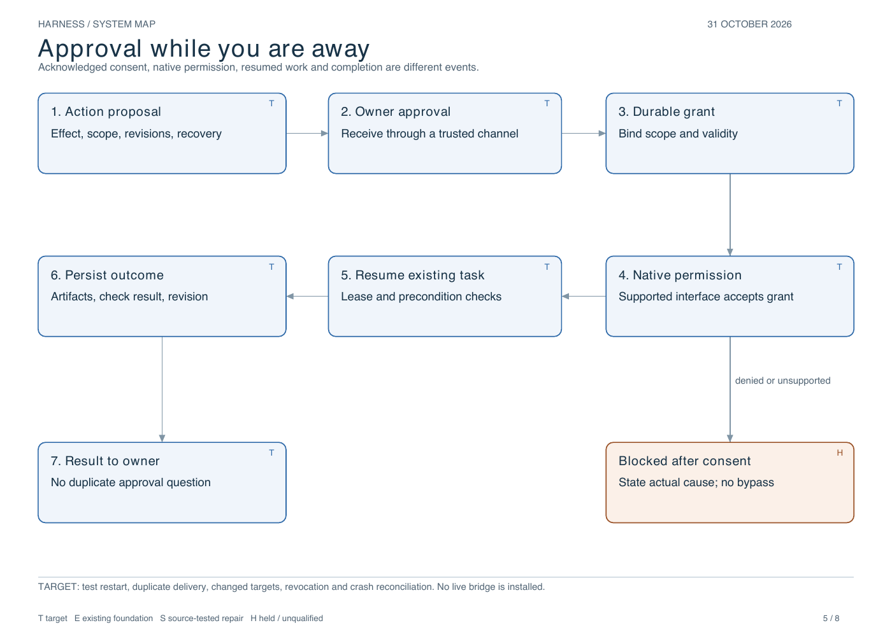
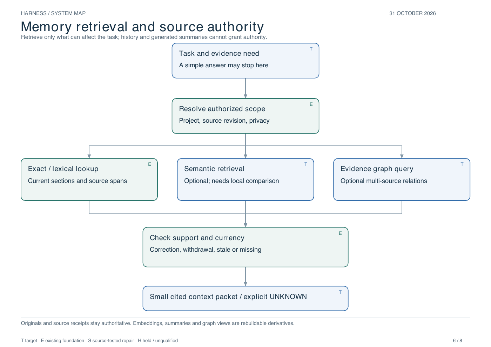
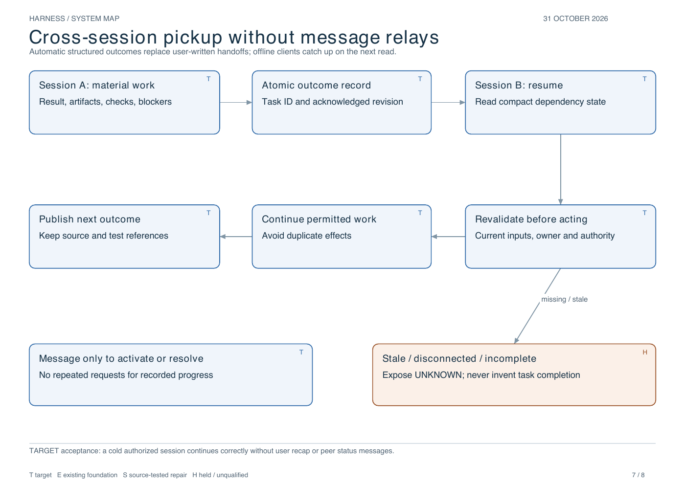
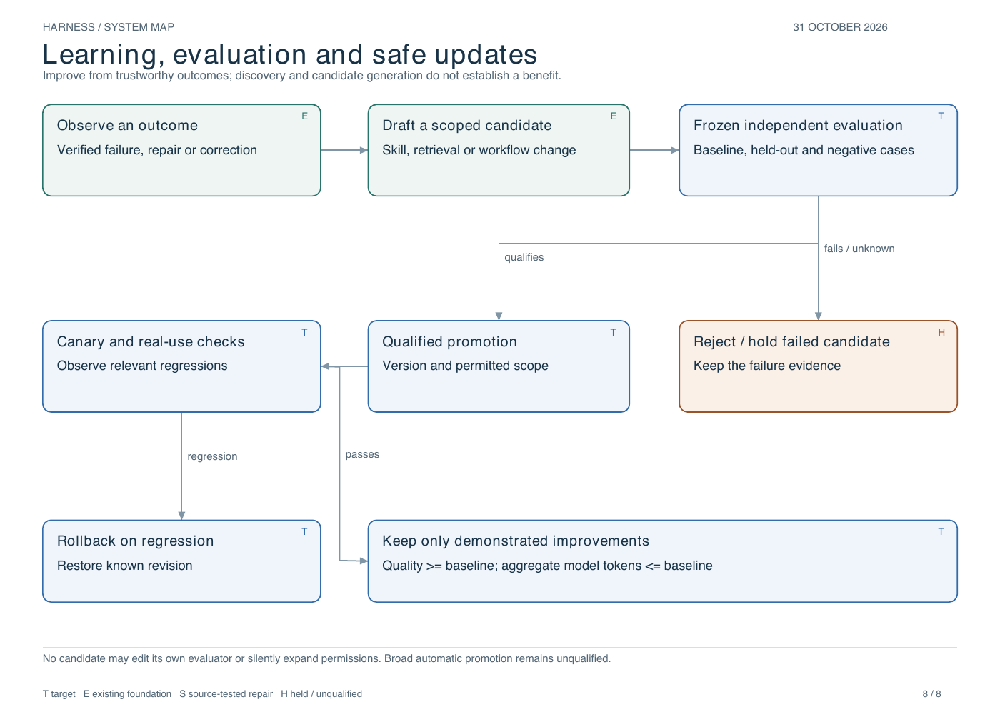

# Harness system map

31 October 2026. The diagrams describe the **target system**, with existing
foundations and held work labeled. They are not a claim that every client runs
the system, the knowledge graph is populated, memory is lossless, token savings
are established or the live approval bridge is repaired.

[Complete eight-page vector PDF](../harness-system-diagrams.pdf).
The canonical design narrative remains [the architecture](../../v1/architecture.md).
The reproducible drawing source is [build.py](build.py). It uses the bundled
ReportLab runtime; it installs nothing and calls no model or external service.

The [new reference review](../reference-review-20261031.md) explains how the two
latest posts affect the memory/learning design, including source recovery,
incremental wiki curation, independent experiment checks and optional Jev routing.
The diagram paths remain proposals; no benchmark gains or native rollout follow
from reading those sources.

| Page | Purpose |
|---|---|
| 1 | System hierarchy: clients, shared control, durable state, knowledge, execution, quality, learning and operations |
| 2 | Adaptive workflow: direct answer, bounded task, exploration or rigorous work, with evidence-driven returns |
| 3 | Decision policy: reason independently about inference depth, evidence breadth, workflow machinery and proof |
| 4 | Guard classification: allowed action, real approval request, uncertain scope or external restriction; separate misfire maintenance |
| 5 | Away-from-machine approval: record consent, verify native permission, resume once, report actual result |
| 6 | Memory retrieval: scope first, choose useful retrieval methods, check source currency and return citations or UNKNOWN |
| 7 | Cross-session pickup: atomic outcomes and revision reads, with no user-written handoff or routine status relays |
| 8 | Learning and updates: independent evaluation, controlled promotion, monitoring and rollback |

## Mechanism and authority

The user specifies an outcome. Task admission chooses a proportionate path.
Only needed context/capabilities are loaded. A single accountable coordinator
uses direct work or bounded workers. The underlying runtime still controls its
permissions and capabilities. Relevant outcome checks establish completion;
material results are published with artifact/revision/evidence references.

Original evidence, task state and approved facts are distinct authorities.
Indexes, embeddings and generated summaries are derived views. Other authorized
sessions inspect current records and retrieve source evidence as needed. Missing
or stale records do not become inferred success. New lessons remain candidates
until independently evaluated and qualified within their authority scope.

## Guard repair in this source revision

Reproduced: Python printing a literal example naming a destructive function or
Wi-Fi operation was classified as executing it. The new, bounded AST check
recognizes only standalone `print` calls whose arguments/keyword values are
literals. It does not exempt arbitrary Python, imports, interpolated strings,
nested calls or a program mixing print with execution. Existing credential,
protected-path, network, wrapper and shell checks stay in place.

The new regression first failed for the expected false-positive reason. After
the repair, positive and executable-expression negative cases pass. The hook
entry point is covered. A mutation replacing the recognizer with an unconditional
true result is rejected by the negative-case test; fixture commands are never
executed. This is a narrow source repair, not complete semantic understanding.

Verification on this change:

- Guard + check-guard + adapter + plan integration selection: **581 passed,
  2 xfailed**. The expected failures are existing contextless relative-path cases;
  their danger cannot be determined without cwd, and cwd-aware hook controls remain.
- Latest graph-node guard suite: **542 passed, 2 xfailed**, exit 0.
- Ruff on the changed source, test and renderer: PASS.
- Eight PDF pages rendered and inspected; text extraction, node fit/bounds and
  artifact existence checked. One overlapping feedback label and a misleading
  learning-edge attachment were corrected before final inspection.

## Not qualified by this work

- Source changes have not been installed into native hook registrations.
- The source checker still uses its existing binary allow/block protocol. A real
  scoped approval consumer and reliable remote resume are target integration.
- Prior live configuration/maintenance denials are not bypassed by a repository
  test; no blocked operation was rerouted and no network policy was changed.
- No model benchmark, fleet rollout, general false-positive elimination or
  complete safety guarantee is established by these checks.

## Diagrams

