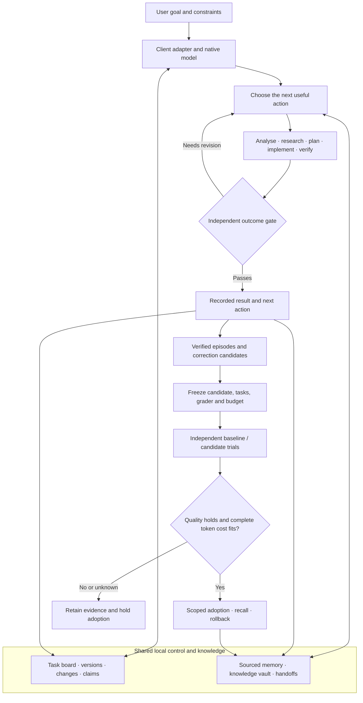

# Harness v3

One local workspace for connected coding clients, with shared task state, sourced memory and evaluated improvements.

Current candidate is **3.0.0rc2**. Its native qualification passed. Local install
and public CI readback are in progress.
The [current qualification report](qualification-20261113.md) records the latest
four-direction results, token measurements and withheld treatments. The older
two-task smoke below remains a historical observation.

## Four directions

| Direction | Purpose |
|---|---|
| Framework and architecture | Shared state, adapters, orchestration, authority and recovery |
| Methodology | Research, implementation, review and outcome evaluation |
| Philosophy and first principles | Assumptions, causal reasoning, tradeoffs and Socratic teaching |
| Knowledge vault | Sourced documents, cases, examples and verified learning episodes |

A reasoning method is selected for its purpose. Socratic teaching belongs in the
philosophy direction. Its sources and examples live in the vault, its teaching
outcomes are evaluated through methodology, and the architecture delivers the
selected guidance to the working model.

## How work moves



## Shared-board behaviour

Connected MCP clients receive a bounded project summary during initialization. Later tool responses carry pending changes. Delivered rows are acknowledged individually, so a context limit preserves omitted work for later retrieval. An unchanged board adds zero repeated board text.

Available native startup, resume, prompt, stop and compaction handlers register advisory lifecycle observations. Checkpoint operations publish results for a cold session. Pure lifecycle observations stay in diagnostic status and are filtered from automatic context.

Writes use version checks and atomic transactions. A stale writer refreshes its view before retrying. Claims use leases and fencing. Project scope comes from the host and successful checkpoint operation. Summaries are redacted before truncation and delivery.

Explicit status remains available through `op_state` or `harness task status --json`. The existing workgraph gate establishes completion. Client hook trust and MCP connection/restart determine when native applications load updated code.

## Learning and adoption

The controller freezes development and held-out inputs before model calls. Actual development outcomes feed a concrete procedure candidate. Independent baseline/candidate runs use a denied answer directory and controller-computed grades. Adoption replays saved requests, answers, source bindings and usage observations.

Acceptance requires every frozen held-out case and required quality dimension, current sources/runtime, complete observed campaign usage, aggregate candidate tokens at or below baseline and a measured gain. Preparation, failed attempts and selection history count toward the candidate. Unknown usage holds adoption.

An accepted procedure is project-scoped and can be recalled, corrected or rolled back. Recalled advice is withheld when its source changes. Public commands expose the same gates.

```sh
harness improve --project "$PROJECT" --prepare-campaign "$SUITE" --oracle-root "$ORACLE" --complete-usage
harness improve --project "$PROJECT" --execute-campaign "$CAMPAIGN" --adopt-if-qualified
harness improve --project "$PROJECT" --rollback "$PROCEDURE"
```

The suite declares its model, effort, exact cases and per-call timeout. The
freeze reports the maximum native call count before execution. Automatic
admission still replays every gate. Capture alone produces candidate evidence.

Transport-fixture tests demonstrate these mechanisms. Native efficacy requires a separately measured campaign.

## Evidence and limits

The 13 November native readback smoke used two tasks and four fresh Codex turns at the same model and effort. Both arms recovered the correct stage and next action for both tasks.

| Measured native turn counters | Retained history | Compact board |
|---|---:|---:|
| Correct readbacks | 2 / 2 | 2 / 2 |
| Input plus output tokens | 51,292 | 48,212 |
| Supplied checkpoint bytes per turn | 7,196 | 573 |

The observed native-counter reduction is 6.0%. Cached input is included. The control uses retained historical checkpoints; this small synthetic-task smoke supports that bounded comparison. Complete provider/workflow cost, all-client native ingestion and general productivity remain unqualified. Codex's JSON event stream supplies the counters. [Official OpenAI documentation](https://learn.chatgpt.com/docs/non-interactive-mode#make-output-machine-readable)

Machine-readable receipts and commands are under `.harness-work/v3-readiness-20261113/`. The current work graph is `plan/v3-readiness-20261113.md`.

The earlier v3 experiments retain their original verdicts. Semantic reranking reduced retrieval quality. Dreaming's orphan-selection arm remains dormant. Unlearning and backflow protections have bounded supporting results. See [the as-built architecture](architecture-v3-draft.md#7-as-built-addendum-2026-11-11) and [track outcomes](outcome-table-20261111.md).

## Release state

**3.0.0rc1 is installed on the Mac Studio.** Cold verification checked 127
packaged files and two fresh installed-server processes. Default board pickup
and stale-write rejection passed. The prior runtime and shared guidance have
transaction backups.

Loaded clients need a new MCP connection. Other devices are NOT_RECHECKED.
Publication candidate is [PR5](https://github.com/oscar-chw/agent-harness/pull/5).
Stable release remains unqualified. This release candidate has 3,020 passing
regression tests, 2 skips and 2 expected failures. Broader model/client uptake,
general coding-learning efficacy and the older v2 retrieval gate retain their
qualification gaps.

The tested native learning candidate remained held on token cost. Successful
adoption and rollback have qualified-transport fixture coverage. These evidence
levels stay separate in the receipts and handoff.
