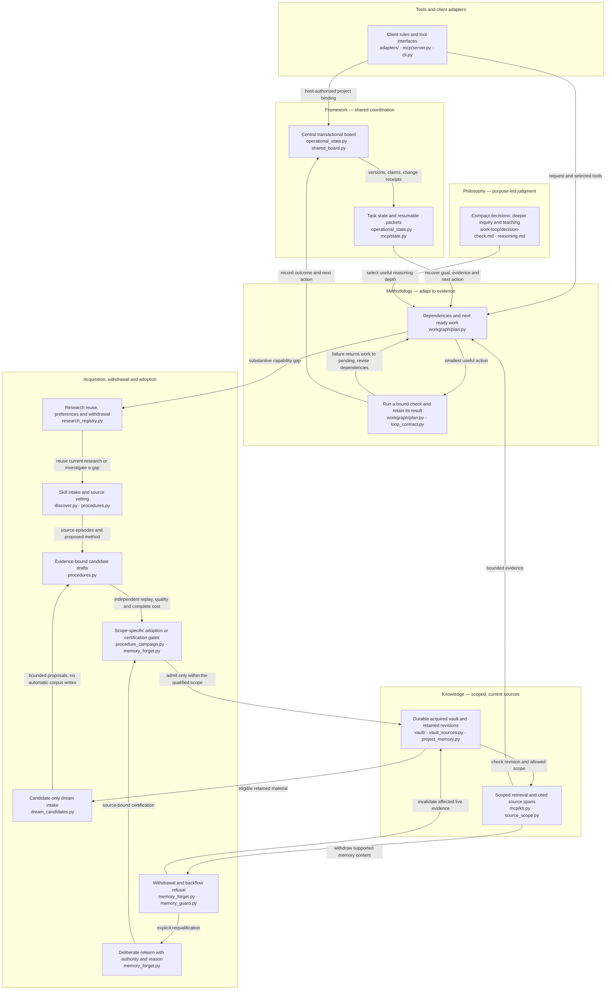

# v3 architecture and readiness

17 November 2026. v3 aims to make useful work easier to resume, verify and improve with less repeated context. Published **3.0.0** integrates the four directions below. Mac Studio now has **3.0.0** installed with byte-verified rollback data; native configuration, owner guard and user memory were preserved. The active goal is `v3-finalisation-20261117`; source checks and installation are separate evidence layers. This is a dated source-and-evidence snapshot. [Finalisation plan](../../plan/v3-finalisation-20261117.md), [completed research integration](../../plan/research-reasoning-20261117.md)

## How the parts work together

Four directions share a task and knowledge system. Framework supplies coordination, methodology selects the next useful action, philosophy guides judgment and explanation, and knowledge supplies scoped evidence. Simple requests stay direct. Dependencies and failed checks justify deeper investigation or backtracking. These mechanisms support efficient, usable v3 without imposing a chore list on every task. [Adaptive work loop](../../content/skills/work-loop/SKILL.md)

Arrows describe available mechanisms or client-directed workflows. Structured State saves publish resolvable packets; research withdrawal overrides advisory reuse. Dream scores create candidates, and a candidate-bound independent gate is required before a link can be applied. Task state carries continuation references, while graph gates establish node completion. The board is advisory. Host project binding, installed hooks and model behavior determine which paths a client actually exercises. Universal automatic adherence across devices or providers remains unqualified.

### Source map and rationale

- Shared state uses SQLite transactions, expected-version checks, idempotency and fenced leases. Per-reader changes reduce duplicate context. Existing explicit checkpoints carry the goal, packet and next action. Legacy continuation state remains a separate entry point. [Operational state](../../src/agent_harness/operational_state.py), [board delivery](../../src/agent_harness/shared_board.py), [continuation state](../../src/agent_harness/mcp/state.py)
- The graph permits dependency-driven work and records failed gates for another attempt. Comparison contracts bind quality and usage to a particular scope. Purpose-led reasoning keeps direct answers short and expands teaching when requested. [Work graph](../../src/agent_harness/workgraph/plan.py), [comparison contracts](../../src/agent_harness/loop_contract.py), [reasoning guidance](../../content/skills/work-loop/reasoning.md)
- Retained revisions support audit and correction. Scoped retrieval supplies selected evidence with citations. Client adapters expose different combinations of rules, hooks and tools. [Source vault](../../src/agent_harness/vault_sources.py), [project memory](../../src/agent_harness/project_memory.py), [KB retrieval](../../src/agent_harness/mcp/kb.py), [scope checks](../../src/agent_harness/source_scope.py), [adapters](../../src/agent_harness/adapters), [MCP server](../../src/agent_harness/mcp/server.py), [CLI](../../src/agent_harness/cli.py)
- Research records retain source hashes and preference digests. Skill intake vets proposed components. Procedure adoption requires separately replayed evidence and complete campaign cost. Capability discovery and confirmation still depend on the client following the protocol. [Research registry](../../src/agent_harness/research_registry.py), [research protocol](../../content/skills/work-loop/capability-research.md), [intake](../../src/agent_harness/discover.py), [candidate procedures](../../src/agent_harness/procedures.py), [adoption controller](../../src/agent_harness/procedure_campaign.py)
- Withdrawal uses a hash-chained tombstone ledger and lexical backflow checks. Relearn requires explicit authority, reason and bound restoration evidence. Dreaming produces guarded proposals whose usefulness must earn admission. Parameter-level erasure and general semantic synthesis remain outside the established evidence. [Withdrawal and relearn](../../src/agent_harness/memory_forget.py), [backflow guard](../../src/agent_harness/memory_guard.py), [dreaming](../../src/agent_harness/memory_dreaming.py), [dreaming v1](../../src/agent_harness/memory_dreaming_v1.py)

## Capability, evidence and limits

| Capability | Evidence available on 17 November | Readiness limit |
|---|---|---|
| Research reuse and scoped discovery | Research plan 6/6 PASS, including source checks, installed-hash checks and cold-process KB retrieval. | Applies to the local overlay. Research quality and model adherence need separate evidence. |
| Automatic cold pickup | Explicit checkpoint and shared-board mechanisms exist. Structured State saves produce immutable packet references with explicit goal and next action. | 53 protocol checks passed. Workspace/project mismatch uses the authorized project-root CLI; an MCP connection cannot redirect its scope. Native model compliance is separate. |
| Memory withdrawal admission | 32 guard and ordinary-entrypoint checks passed, including late configuration, refusal and deliberate relearn. | Lexical coverage and configured store scope bound protection. No weight erasure or removal from already-loaded context. |
| Research withdrawal and relearn | Source-hash reuse exists. Explicit withdrawal and deliberate requalification preserve source revisions, preference review and history. | 44 research-registry checks passed. Registration alone establishes no autonomous research behavior. |
| Reasoning against an unguided baseline | Both arms 24/24 correct. Candidate used **481 more tokens**, 150,194 against 149,713. Rejected. | Equal authored-case scores failed the nonincreasing-token criterion. |
| Existing full-guide compaction | Both arms 24/24 correct across six paired batches. **5,449 fewer tokens**, 150,194 against 155,643, a **3.50%** inference saving. Receipt status `PASS_BOUNDED`, promotion `NOT_GRANTED`. | Authored closed-world decisions only. General intelligence and net project savings remain unestablished. Preparation cost is UNKNOWN. |
| Dreaming | Historical orphan-link precision **0.6034**, below required **0.80**. Overall verdict DISCONFIRMED. Candidate-only intake and candidate-bound admission are implemented. | Failed orphan arm stays held. 53 dream mechanics checks passed; every proposed link still needs an independent semantic check. |
| Native cold-session pickup | Two distinct fresh Codex sessions recovered the original and changed State packet, with no false completion claim or chat relay. | Reported input/output cost **429,149 tokens**. The local probe failed to enforce its 90,000-token planning ceiling between calls. Pickup works in these two cases; cost control and efficient general uptake are not established. |
| Learned methods and teaching | Procedure campaign gates and authored philosophy cases exist. Earlier generated-method campaign remains held on complete cost. | Broad framework benefit, learner transfer and general workplace efficacy remain unmeasured. |
| Release and client reach | Mac Studio 3.0.0 passed the full source gate (3,203 passed, one skip, two expected failures), offline wheel install, cold memory/State/KB checks, five-step installed demo and doctor (17.9 MB / 20 MB base). | Release CI, downloaded asset hashes and142 installed-source bindings passed. MacBook activation failed at the app interface; device parity and any-provider automatic adherence remain unqualified. |

Counts retain their original scopes and exact commands in the linked graph. Historical native experiments are bound to archived controller/source hashes. Later integrated runtime changes require their own installation checks; the native comparison is not a new whole-harness benchmark. [Research gates](../../plan/research-reasoning-20261117.md), [active integration gates](../../plan/v3-finalisation-20261117.md), [rejected comparison](../../eval/results/reasoning-iteration-20261117.json), [compaction receipt](../../eval/results/reasoning-compaction-20261117.json), [dreaming verdict](h6c-dreaming-v1-verdict-20261110.md), [prior qualification](qualification-20261113.md)

## Short demonstration path

Use an authorized project with the local overlay already available. The commands below inspect existing state and source-bound research without launching a model.

1. Run `harness task status --json` to see the project's current task, packet reference and next permitted action. An empty board provides no pickup evidence.
2. Run `plan status v3-finalisation-20261117`, then `plan context v3-finalisation-20261117 2` to inspect the automatic-pickup requirement and its exact gate. Read the referenced packet when available.
3. Run `harness research check research-paper` to inspect the recorded capability, current source support and saved-preference review state. A stale or missing record calls for scoped research under the existing protocol.
4. Compare the two public reasoning receipts above. The retained rejection and bounded compaction result show how a proposed improvement earns a limited claim. Use the current source/installed gate receipt to distinguish available code from the running client. Acquisition guidance reuses completed source-bound research and checks saved preferences before upgrades.

The intended experience is a direct request, relevant context recovery, useful action and a checked result. Deeper acquisition or learning happens when a substantive gap justifies it.

Native readback failures and costs are retained in [the probe receipt](../../eval/results/v3-native-board-readback-20261117.json). No further native calls were launched after this two-call demonstration. Existing board delivery tests establish changed-packet delivery and zero added board bytes at unchanged boundaries; they do not measure the native client's whole context cost.

## Release readback

[Stable v3.0.0](https://github.com/oscar-chw/agent-harness/releases/tag/v3.0.0) is published from tested commit `c4233aad934094984f6b34b8d023316aa2e89202`, merged into main with an identical tree. The root-owned full gate passed **3,203 tests**, with one skip and two expected failures. Downloaded assets,142 source/installed package bindings, rollback bytes and the five-step installed demo passed. [Machine-readable receipt](../../eval/results/v3-release-readback-20261117.json).

The MacBook update could not be activated through either existing chat: the app returned request `1891835f-5560-4798-bd20-cfcb87d1bd9f`. Its latest inspected state remains the earlier completion, so this is **NOT_VERIFIED**, not rollout success. The graph keeps that device gate open. New native calls were not used to work around this failure. Existing loaded MCP clients need reconnection to load new runtime code.
