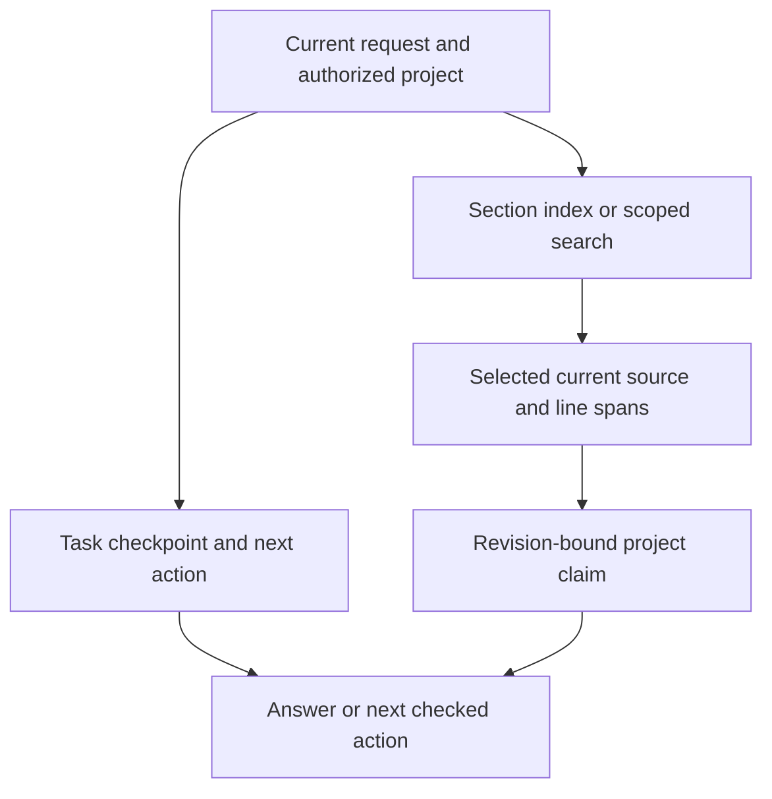

# Memory hierarchy and knowledge

Retain each kind of information where its meaning and recovery rules are clear. Fetch the smallest relevant current evidence, and keep a route back to its source.

## Mechanism

| Layer | What belongs here | Store or interface |
|---|---|---|
| Operating guidance | Project constraints and task-relevant methods | Installed rules, selected skills and profile overrides |
| Shared task state | Current goal, stage, blocker, evidence pointer and next action | Project-scoped operational SQLite board, op_state and harness task |
| Completion evidence | Dependencies, ownership and dated gate attempts | Repository plan files and graph-owned records |
| Continuation fallback | A compact unfinished-work snapshot | state_save/state_load, bounded STATE.md and prior versions |
| Facts and lessons | User-stated facts, scoped project facts and verified corrections | JSON item stores exposed by mem_* and lesson_* |
| Source-backed project records | Assertions with explicit provenance, confidence, access scope and revision | Project .harness/records with source receipts under .harness/sources |
| Knowledge documents | Original manuals, design notes and examples | Profile-selected kb_paths, sections and source records |
| Retrieval views | Candidate selection and relevant excerpts | Rebuildable SQLite/FTS indexes and lexical ranking |
| Reusable method candidates | A proposed procedure and its qualification history | Procedure lifecycle, independent comparison and scoped adoption gate |

The diagram describes a useful retrieval path. An uncomplicated question can use a shorter path.

## Example

An illustrative deployment note changes its port from 8000 to 9000. A source-backed correction appends a new record linked to the prior receipt. A normal current read refuses a superseded receipt. An explicit historical read retains diagnostic access and marks old material unusable for current decisions. A hash establishes identity and revision. Meaning still needs an appropriate check.

For ordinary document retrieval, a peer may index a changed source before an existing reader refreshes. The KB combines SQLite data_version with the live source set to invalidate relevant in-memory ranking and honesty maps. Unavailable sources retain explicit availability limits.

## Tradeoffs

- The operational board is a small progress packet. Open its checkpoint and gate evidence when the decision needs detail.
- Facts, source records, plans and raw documents have different ownership and access rules. A search index can be rebuilt from retained originals.
- ProjectMemory requires a declared project manifest and explicit provenance. Presence of this interface does not mean every chat automatically writes source-verified records.
- Retrieved text can contain errors or instructions embedded as data. It grants no permission.
- Lexical/FTS retrieval is inspectable and local. Paraphrases and vocabulary changes can still cause misses. Earlier semantic reranking regressed on the evaluated corpus, so those experiments retain their recorded verdicts.
- Shared stores on one host and synchronized knowledge across devices are distinct deployment claims.

## Evidence and limits

Four authored native pairs recovered 4/4 answers per arm. Current source-bound packets used 99,886 observed input/output tokens against 111,825 for retained history, a 10.68% reduction. These bounded readback tasks leave broad coding productivity, universal memory recall and net project savings unqualified.

The deterministic interview run separately shows cold task pickup and zero repeated board bytes at an unchanged boundary. That byte count is narrower than total model-token consumption.

## Implementation

[Source vault](../../src/agent_harness/vault_sources.py) · [Revision-bound records](../../src/agent_harness/project_memory.py) · [Facts and lessons](../../src/agent_harness/mcp/memory.py) · [Continuation state](../../src/agent_harness/mcp/state.py) · [KB and cache invalidation](../../src/agent_harness/mcp/kb.py) · [Scoped vault retrieval](../../src/agent_harness/vault_retrieval.py) · [Measured comparison](../v3/qualification-20261113.md#measured-memory-result)
